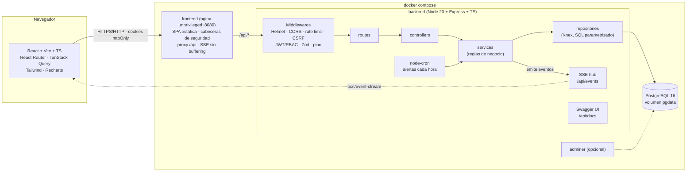

# Arquitectura

**Capas del backend:** `routes` (HTTP + validación Zod + permisos) → `controllers` (traducen request/response) → `services` (reglas de negocio, transacciones, auditoría) → `repositories` (único lugar con SQL).

**Tiempo real:** cada venta, movimiento de inventario o recálculo de alertas publica un evento por SSE; el frontend invalida las consultas afectadas (contador de la barra superior, panel de alertas, stock en el POS, dashboard).
