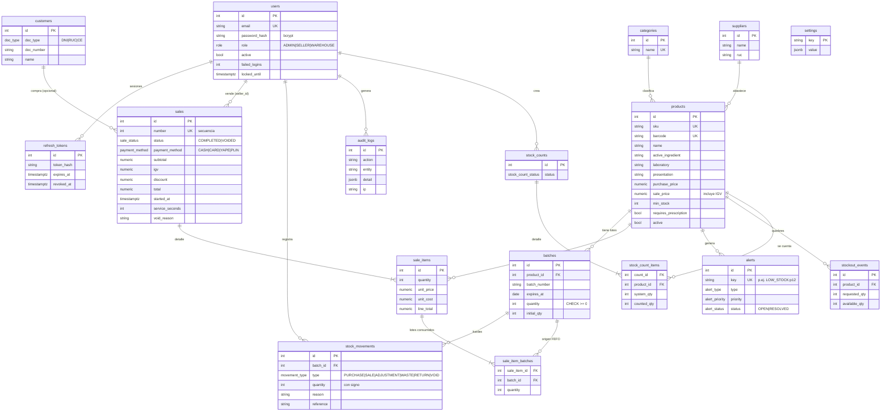

# Modelo entidad-relación

Restricciones clave: `batches.quantity >= 0` (última línea de defensa contra stock negativo), `sales.number` por secuencia, claves únicas en `alerts.key` (una alerta abierta por producto/lote y tipo).
