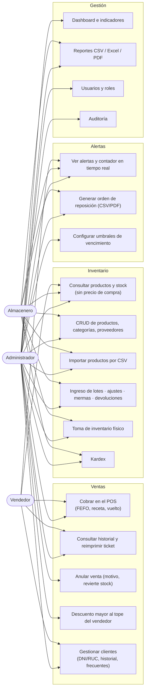

# Casos de uso por rol

| Capacidad | Admin | Vendedor | Almacenero |
|---|:-:|:-:|:-:|
| POS, ventas, clientes | ✔ | ✔ | — |
| Anular ventas | ✔ | — | — |
| Descuentos sobre el tope (`MAX_SELLER_DISCOUNT_PCT`) | ✔ | — | — |
| Ver productos / alertas | ✔ | ✔ (sin precio de compra) | ✔ |
| Crear/editar productos, lotes, ajustes, conteos, kardex | ✔ | — | ✔ |
| Orden de reposición | ✔ | — | ✔ |
| Reportes (ventas: solo Admin) | ✔ | — | ✔ |
| Dashboard, indicadores, usuarios, auditoría, umbrales | ✔ | — | — |

Los permisos se aplican **en el backend** (middleware `authorize`) y se reflejan en el frontend (rutas protegidas y menú).
