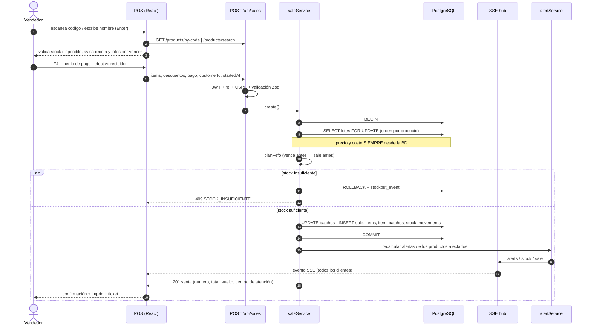

# Secuencia: venta en el POS

**Concurrencia:** dos ventas simultáneas del mismo producto se serializan con `SELECT … FOR UPDATE`; el `CHECK (quantity >= 0)` es la defensa final. Prueba incluida: 20 ventas paralelas sobre 5 unidades → 5 aceptadas, 15 rechazadas, stock = 0.
